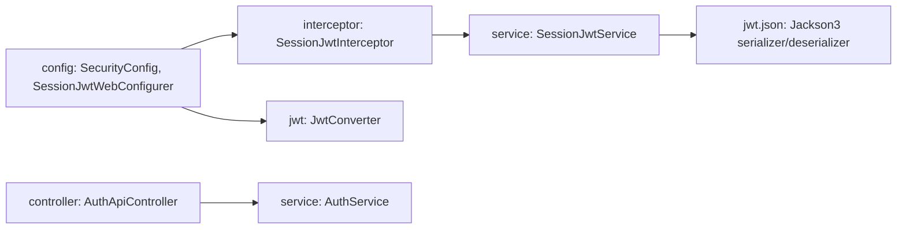
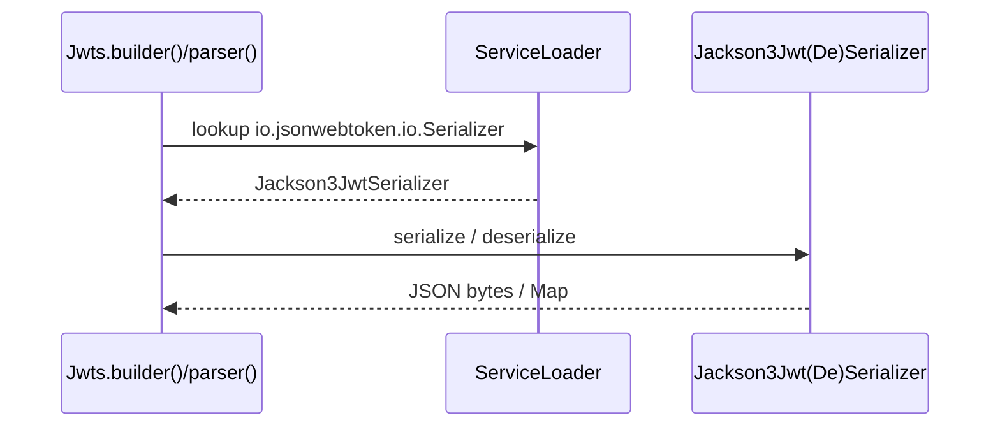

# UMDC Security OAuth – Technical Guide

## Stack
Java 25, Spring Boot 4.1.2, Spring Cloud 2025.1.4, Spring Security 7, JJWT 0.13.0, Jackson 3.2.4.

## Package overview

## Jackson 3 migration for JJWT
JJWT 0.13.0 only ships a Jackson 2 module (`jjwt-jackson`). To avoid `com.fasterxml.jackson.core:jackson-databind`
(flagged by Snyk) the project:

1. Removes `jjwt-jackson` and declares `tools.jackson.core:jackson-databind` (`${jackson3.version}`).
2. Implements `io.jsonwebtoken.io.Serializer` / `Deserializer` in `com.umdc.security.jwt.json`:
   - `Jackson3JwtSerializer` – serializes claims/headers; `io.jsonwebtoken.lang.Supplier` values are written as their content.
   - `Jackson3JwtDeserializer` – reads into `Map`/`List`; enables `STRICT_DUPLICATE_DETECTION` and `FAIL_ON_TRAILING_TOKENS`.
3. Registers them in `META-INF/services/io.jsonwebtoken.io.Serializer` and `...Deserializer`, which JJWT loads with `ServiceLoader`.

Jackson 2 artifacts that remain (`jackson-databind`, `dataformat-yaml`, `datatype-jsr310`) are transitive from
`swagger-core` via `commons-services` and are pinned to `${jackson-2-bom.version}` (2.22.4).

## Security pins (`dependencyManagement`)
Tomcat `${tomcat.version}`, Hibernate Validator `${hibernate-validator.version}`, Objenesis `${objenesis.version}`,
Netty, Logback, BouncyCastle, Log4j, Commons Compress.

## Quality gates
- `mvn verify` runs PMD, unit tests and JaCoCo checks (line ≥ 80 %, branch ≥ 70 % per package).
- Project policy: method coverage ≥ 85 % (currently 88.5 %).
- Report: `target/site/jacoco/index.html`.
