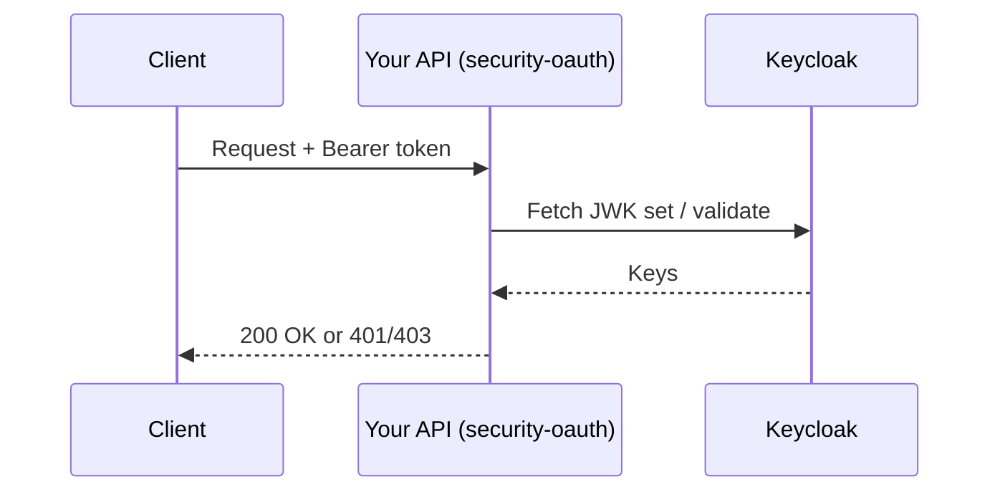

# UMDC Security OAuth – User Guide

Library that secures Spring Boot APIs with OAuth2/JWT (Keycloak) and adds session JWT validation.

## Requirements
- Java 25, Spring Boot 4.1.x.

## Add the dependency
```xml
<dependency>
    <groupId>com.umdc</groupId>
    <artifactId>security-oauth</artifactId>
    <version>0.0.3</version>
</dependency>
```

## JSON handling for JWT (Jackson 3)
JWT creation and parsing with JJWT (`Jwts.builder()` / `Jwts.parser()`) uses **Jackson 3** (`tools.jackson`)
automatically; no configuration is required. Do **not** add `io.jsonwebtoken:jjwt-jackson` (Jackson 2) to your
project, otherwise JJWT may pick the Jackson 2 implementation.

## Minimal configuration
| Property | Purpose |
|---|---|
| `umdc.api.endpoint` | Base path protected by the library (e.g. `/api/v1`) |
| `umdc.management.clientRoles` | Roles allowed to call the protected API |
| `spring.security.oauth2.resourceserver.jwt.jwk-set-uri` | JWK set used to validate access tokens |

## Request flow


## Skipping session validation
Annotate a controller method with `@SkipSessionValidation` to bypass the session JWT interceptor.

## Troubleshooting
- `401`: token invalid or expired.
- `403`: user lacks a role listed in `umdc.management.clientRoles`.
